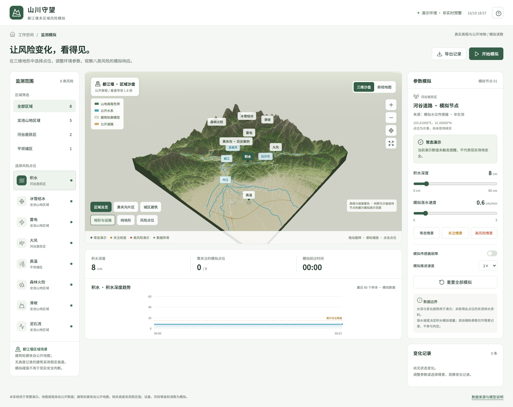
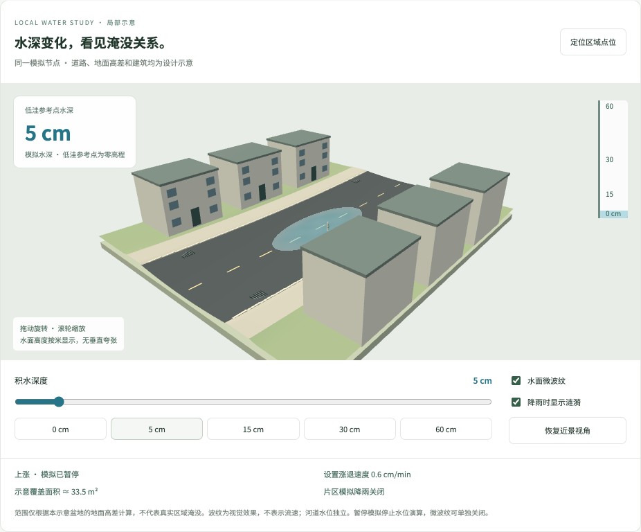
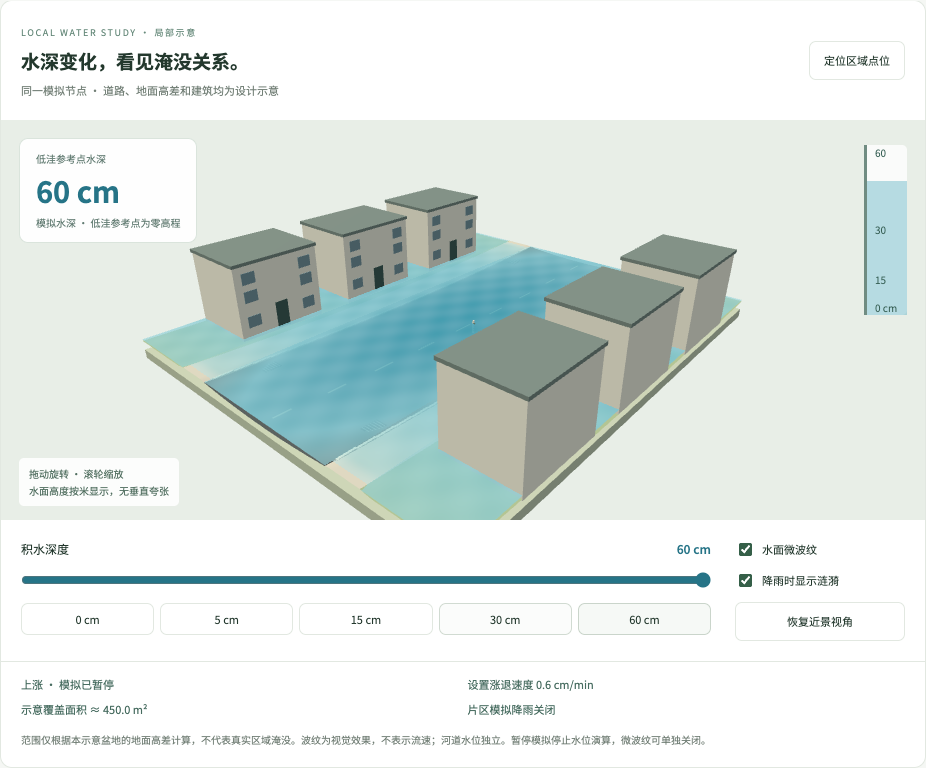
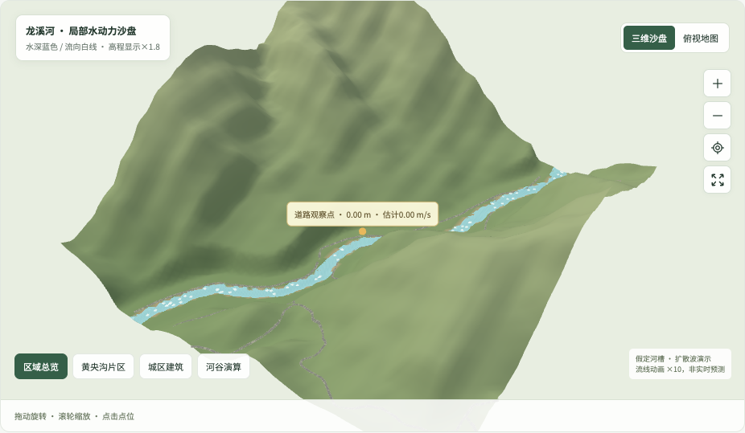
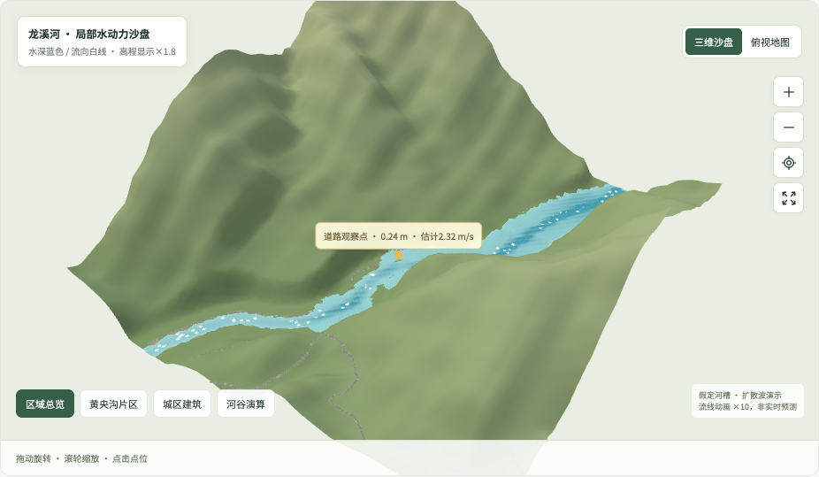
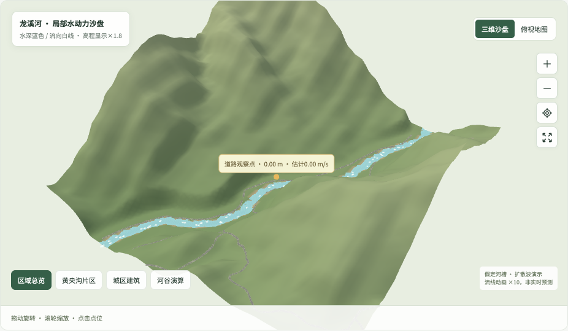

# 山川守望 都江堰监测模拟

[在线体验](https://yun999-ccc.github.io/dujiangyan-risk-monitor/) · [源码仓库](https://github.com/yun999-ccc/dujiangyan-risk-monitor)



仅实现第一站：监测模拟页。三维沙盘、俯视指挥地图、八类独立输入、证据说明和情景时间线均可操作。管理指挥页、现场警示页和跨设备共享后端留待后续。

## 运行

```sh
npm install
npm run dev
npm test
npm run build
```

## 数据真实性

- 高程：Mapzen Terrain Tiles / AWS Open Data，Terrarium，513×513重采样；展示范围103.46—103.73E、30.94—31.17N。垂直夸张1.8倍，非工程测量。
- 水系、道路、建筑、部分用地轮廓：OpenStreetMap API 0.6，2026-10-10取得；仅覆盖两个矩形查询片区，可能不完整。
- 建筑：420条公开轮廓，缺少高度时假定12米。没有真实立面或屋顶数据。
- 黄央沟沟口：按2014年《都江堰市龙池镇黄央沟泥石流特征与防治工程效果分析》的文献坐标定位；坐标基准未注明，定位不能视为测绘级准确。只代表历史案例沟口，不是当前危险范围。
- 其余节点：示意布置。全部读数、阈值与风险状态均为模拟，不是实时预警。
- 预设情景与自动推进用于交互展示，不是经校准的灾害模型。不能推断安全通行或真实灾害概率。
- 道路与河道显示宽度为示意；地形按高程和坡度着色，使用坡面明暗与颗粒材质；装饰树群不代表真实植被位置、数量或尺寸。

## 开源数据许可

OpenStreetMap contributors，ODbL： https://www.openstreetmap.org/copyright
Mapzen Terrain Tiles： https://registry.opendata.aws/terrain-tiles/
论文： https://xbdz.net.cn/cn/article/pdf/preview/20140323.pdf

## 后续联动接口

`src/model.js`中的状态、点位ID和事件可复用。当前数据仅保存于本浏览器；后续应由共享后端处理状态转换、版本和权限，再通过实时连接推送给三个客户端。当前版本没有跨设备同步。

## 使用技能

主技能：cesartevisual/threejs-skills 中的 threejs-web、threejs-spatial-data、threejs-interaction、threejs-testing。
排版补充：anthropics/skills 中的 frontend-design。
技能仅作为开发指导；运行本项目不需要安装技能。

## GitHub Pages

推送 main 后，GitHub Actions 安装依赖、执行逻辑测试、构建并部署 dist。构建资源和数据请求使用相对路径，兼容仓库子目录。

## 浏览器测试

```sh
npx playwright install chromium
npm run dev
# 另开终端
npm run test:browser
```

若使用本机 Chrome，可通过 CHROME_PATH 环境变量指定可执行文件。模拟窄屏检查不能代替真实手机GPU测试。

## 项目结构

```text
src/            界面、三维模型与模拟状态
public/data/    已打包的公开高程和地图矢量
tests/          状态与浏览器测试
scripts/        数据处理与截图辅助
assets/         真实运行截图
```

## 网络依赖与权利说明

核心地形和矢量文件随网站发布，无需地图密钥；字体尝试通过Google Fonts加载，失败时使用系统中文字体。案例来源链接需要网络。

源码暂未授予额外开源许可；公开展示不等于授予任意复用权限。OpenStreetMap衍生数据保留ODbL义务；其他依赖按各自许可证使用。本项目不是政府或景区官方预警系统。

城区建模：建筑高度统一采用1.8倍展示，按公开高程补齐基座，窗格和屋顶边缘为示意立面。深灰机动车道采用贴地面片；优先取宽度标签，否则按车道数或道路等级估计。街巷、步道与主干道分别显示，路缘与标线不是测绘结果。公开建筑覆盖不完整。


### 模拟实验台使用

1. 手动保持：选择风险，使用数字输入、滑杆及现场证据选项。开始模拟只推进时钟，主参数保持不变。
2. 情景轨迹：展开“所选参数的变化轨迹”，勾选并输入结束目标；设置1—120分钟时长，点击“生成情景 / 应用轨迹”。
3. 播放或拖动时间线；回到起点可重播。手动改主参数会关闭该项轨迹，改为全程固定的新值；也会关闭该积水节点的自动涨退、或泥石流节点的共享降雨。
4. 积水可选择按正负涨退速度演算。片区降雨从起始值线性变为结束值，累计量按模拟秒积分；只有勾选关联的泥石流读取雨强，关联滑坡读取累计雨量背景而不改变位移。积水只展示背景。
5. 故障冻结读数；缺失、过期及到期模拟雷电信号显示未知。结冰、烟火等模拟巡查记录必须手动更新，不随指标回落自动消失。

阈值全部为可修改的演示配置；冰雪还结合路面与巡查证据。未接入真实传感器、官方预警或经过验证的灾害模型。湿度、活动时长等背景条件展示在判断依据中，不计算医学风险或正式火险指数。地图选中节点显示读数与核查状态，圈面仍为示意。

播放倍率仅改变时间推进；1×下1现实秒对应1模拟秒。过程模型使用模拟秒计算，不额外乘速度。状态使用本浏览器localStorage v2，刷新自动暂停；未实现跨设备共享后端。导出JSON包含模拟状态、规则版本、轨迹基线和操作记录，可在代码中重放（尚无网页导入功能）。

山区道路显示优化：以道路采样高程的中位数划分展示样式（约950米以上），采用灰绿色路面与窄路缘；跨越平地与山谷的道路随高程渐变配色，取消高程较高区段的示意中心标线。仅缺少宽度和车道数的次级道路限制估计展示宽度；OSM明确宽度与车道数仍优先使用。路面内部自适应细分贴合三角地形，转弯采用有限斜接。此高程划分仅用于沙盘配色，不代表实际路面材料或山区行政边界。

### 道路积水近景

选择积水后显示独立可旋转的三维道路近景，0—60 cm 连续水深与主参数双向联动。局部地面为设计的低洼道路、抬高人行道及六栋示意建筑；平面水面依局部高差裁剪，建筑内部不计入覆盖面积。面积按0.25米网格估算，仅针对本示意模型，非区域淹没预测。水面微波纹与降雨涟漪可单独关闭；雨强为零或未启用片区降雨时无涟漪。没有流速、排水或真实建筑入口模型。数据异常保存最近有效水深，刷新后仍保留并标记未知。暂停停止水深演算，视觉微波纹可继续或关闭；减少动态效果的设备默认关闭微波纹。

| 5 cm 浅水示意 | 60 cm 深水示意 |
| --- | --- |
|  |  |

### 龙溪河局部河谷演算

在区域沙盘点击「河谷演算」，或打开网址时添加 `&river=1`，切换主沙盘为龙溪河黄央沟邻近片区的局部计算地形。可以修改起始、峰值、结束来水量，降雨、有效降雨比例、道路排水能力与受阻状态，并查看流动、漫岸和退水阶段。手动水深输入在此模式下隐藏，其他七类风险与原道路积水近景保留；选择其他风险自动退出河谷模式。

公开来源：原DEM和OSM龙溪河中心线（way 219484805）与邻近8条道路要素。计算域约1.536×1.536 km，96×96单元、16 m插值网格，未增加原始测绘精度。该域公开建筑轮廓为0条，不代表真实没有建筑。假定断面默认宽48 m、深3 m，沿中心线平滑并去除反坡，岸外96 m内设计缓坡衔接原DEM。计算和局部三维展示共用修改后的网格；显示高程×1.8，计算长度、面积、时间、水量均使用原始SI单位。道路观察点为公开道路附近网格中心（约103.56158°E、31.07218°N），非现场传感器。

模型：独立实现的显式扩散波近似，面通量使用宽浅水曼宁关系，由水面坡降驱动，交换单元体积严格守恒。忽略完整惯性动量、泥沙、管网和溃坝冲击。计算步长≤0.5 s；每步供水限流至单元水量的35%，保持非负；限流会影响流速、洪峰和结果，界面报告受限面数量，未做实测校准或网格收敛验证。下游是固定参考水深、只出不进的边界，其他边界封闭。有效降雨按比例进入非建筑单元，其余记为假定损失；道路排水在有水道路单元分配，不超过可用水量。

[扩散波理论说明（HEC-RAS）](https://www.hec.usace.army.mil/confluence/rasdocs/ras1dtechref/6.6/theoretical-basis-for-one-dimensional-and-two-dimensional-hydrodynamic-calculations/2d-unsteady-flow-hydrodynamics/hydraulic-equations/diffusion-wave-approximation-to-the-shallow-water-equations)。本网页不是HEC-RAS软件，也不具有该工程软件的精度与验证范围。

流线按面通量估计的方向与速度移动，动画位移×10，独立于水量演算时间，可关闭。播放10×、30×、60×指每个推进周期请求对应模拟秒数，计算中不会追加重叠请求；设备较慢时墙钟推进可能低于设置倍率，界面时间为实际完成的模拟时间。暂停冻结已完成结果，回放从同一初始状态重算。峰值没有当地频率或重现期意义；阶段按钮只是固定时间定位，修改参数后不保证该时刻仍漫岸。刷新后河谷演算重新从起点开始；导出保存本次参数、网格深度和流速、收支与边界说明。

| 河槽流动 · 默认条件1分钟 | 漫岸 · 默认条件15分钟 | 退水 · 默认条件60分钟 |
| --- | --- | --- |
|  |  |  |

截图为上述假定参数的演示结果，不能解读为当地真实灾害过程。覆盖面积按单元水深>5 cm计数；蓝色水面绘制阈值为2.5 cm，并进行网格间插值。
